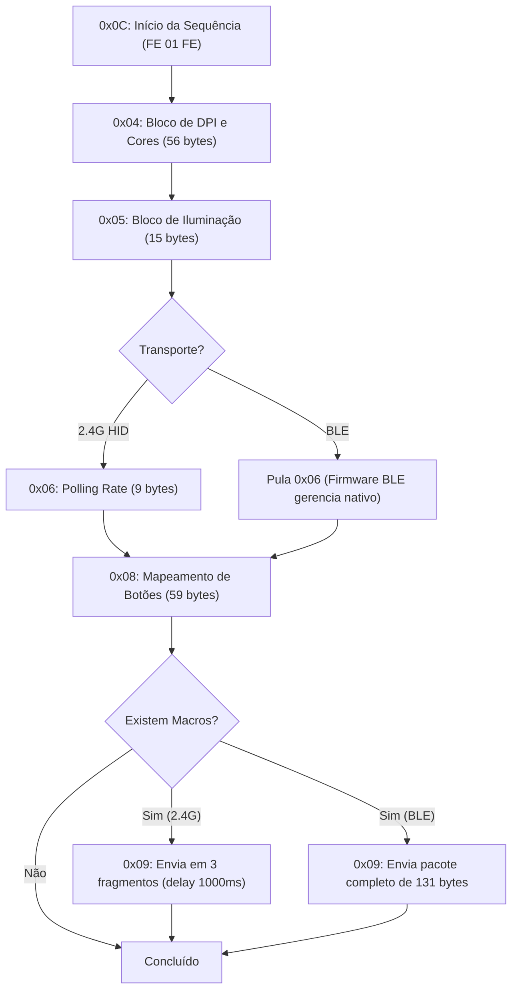

# Arquitetura de Hardware — X11 Management IMS (Integrated Management System)

Este documento descreve a especificação técnica dos endpoints de hardware, transição de comandos, estrutura de relatórios HID/BLE e layout binário de memória do mouse X11 no Integrated Management System (IMS).

---

## 1. Identificação do Dispositivo

| Parâmetro | Modo Wireless 2.4GHz | Modo Bluetooth (BLE) |
|---|---|---|
| **Vendor ID (VID)** | `0x1D57` | `0x045E` (Microsoft compat) |
| **Product ID (PID)** | `0xFA60` | `0x0055` |
| **Nome amigável** | X11 Wireless Receiver | `X11mouse1` |
| **Endpoint de Escrita** | Feature Report 134 (`col04`) | Característica GATT `0xFEE3` (serviço `0xFEE0`) |
| **Endpoint de ACK/Eventos** | Input Report 5 (`col03`) | Notificação GATT `0xFEE4` (CCCD handle 28) |

---

## 2. Sequência de Aplicação de Configuração

Ao aplicar um perfil, os comandos são transmitidos na seguinte ordem:



Cada pacote transmitido aguarda resposta do firmware antes de avançar para a próxima etapa.

---

## 3. Formato dos Pacotes de Hardware

### 3.1. DPI — Comando `0x04` (56 bytes)
- **Cabeçalho**: `04 38 01` (cmd `0x04`, tamanho 56, subcomando 1).
- **Bytes 3–4**: Flags de Angle Snap e Ripple Control.
- **Byte 5**: Máscara de bits dos estágios habilitados (bits 0–7 para estágios 1–8).
- **Bytes 6–7**: Flags de DPI alto (> 12000).
- **Bytes 8–15**: Índices mapeados pela tabela `dpi_lookup`.
- **Bytes 16–23**: Flags de faixa estendida (101..120 ou >= 201).
- **Byte 24**: Estágio selecionado (1-based).
- **Bytes 25–48**: Cores RGB de cada estágio (3 bytes por cor: B, G, R).
- **Bytes 50–51**: Checksum big-endian de 16 bits da soma `bytes[3..50]`.

### 3.2. Iluminação — Comando `0x05` (15 bytes)
- **Cabeçalho**: `05 0F 01` (cmd `0x05`, tamanho 15, subcomando 1).
- **Byte 3**: Modo de LED `(mode << 4) & 0xFF`.
- **Byte 4**: `((sleep & 0xF0) | (9 - speed)) & 0xFF`.
- **Byte 5**: `((sleep << 4) | brightness) & 0xFF`.
- **Bytes 6–8**: Cor RGB (3 bytes).
- **Byte 9**: Tempo de luz apagada.
- **Byte 10**: Debounce de teclas (`key_response_time`).
- **Bytes 11–12**: Checksum big-endian `bytes[3..11]`.

### 3.3. Polling Rate — Comando `0x06` (9 bytes)
- **Cabeçalho**: `06 09 01`.
- **Byte 3**: Código de amostragem (`8` = 125Hz, `4` = 250Hz, `2` = 500Hz, `1` = 1000Hz).
- **Byte 4**: Complemento de um do código `(valor ^ 0xFF)`.
- **Bytes 5–8**: Zeros de preenchimento.

### 3.4. Botões e Atalhos — Comando `0x08` (59 bytes)
- **Cabeçalho**: `08 3B 01` (cmd `0x08`, tamanho 59, subcomando 1).
- **Bytes 3–56**: 18 slots de botões x 3 bytes por ação (extraído de `action_rows_u32`):
  - Ação `0x10` (Atalho de teclado): `[0x17, key_code, modifier_code]`.
  - Ação `0x11` (Macro): `[0x18, 0x00, slot_number]`.
- **Bytes 57–58**: Checksum big-endian `bytes[3..57]`.

### 3.5. Macro — Comando `0x09` (131 bytes)
- **Cabeçalho**: `09 83 <slot>` (slot 1..18).
- **Byte 7**: Número de repetições.
- **Byte 28**: Contagem total de eventos (máximo 46 eventos com expansão de atraso).
- **Bytes 29..128**: Eventos pares `(delay_coded, key_code)`.
- **Bytes 129–130**: Checksum big-endian.

---

## 4. Estrutura do Arquivo `pro.data`

O arquivo `pro.data` armazena a memória persistente dos perfis:

```
+--------------------------------------------------------+
| Prefixo / Cabeçalho Opaco: 164.964 bytes (0x28464)    |
| (Preservado integralmente para compatibilidade de fw)  |
+--------------------------------------------------------+
| Perfil 1: 32.992 bytes (0x80E0)                       |
|   +0x000: Nome do perfil (UTF-16LE, 100 chars)         |
|   +0x8C4: Tabela DPI X (8 x u32)                      |
|   +0x8E4: Tabela DPI Y (8 x u32)                      |
|   +0x904: Tabela DPI Habilitado (8 x u32)              |
|   +0x924: Brilho (u32)                                |
|   +0x928: Velocidade do efeito (u32)                   |
|   +0x92C: Sleep timer em minutos (u32)                 |
|   +0x930: Light-off minutos (u32)                      |
|   +0x934: Estágio de DPI selecionado (u32)             |
|   +0x938: Índice de Polling (u32)                      |
|   +0x94C: Modo de LED (u32)                            |
|   +0x958: Key response time / debounce (u32)           |
|   +0x95C: Cor do LED (ColorRef u32)                    |
|   +0x960: Cores dos estágios de DPI (8 x ColorRef u32) |
|   +0x9A0: 24 Registros de Botão (24 x 0x4F8 bytes)     |
+--------------------------------------------------------+
| (Opcional) Perfil 2..N: 32.992 bytes cada              |
+--------------------------------------------------------+
```

---

## 5. Protocolo de Resposta (ACK) e Monitor de Bateria

O receptor envia relatórios de entrada de 5 bytes no formato:
`03 55 <evento> <valor_u16_le>`

- **ACK de Comando (`evento = 0x50`)**:
  - `03 55 50 00 <cmd>`: Sucesso / Aceito.
  - `03 55 50 01 <cmd>`: Erro / Rejeitado.
- **Relatório de Bateria (`evento = 0x40`)**:
  - Byte 3: Status de carregamento (0x01 = descarregando/wireless, 0x02 = carregando/com fio).
  - Byte 4: Nível percentual de bateria (0 a 100%).
